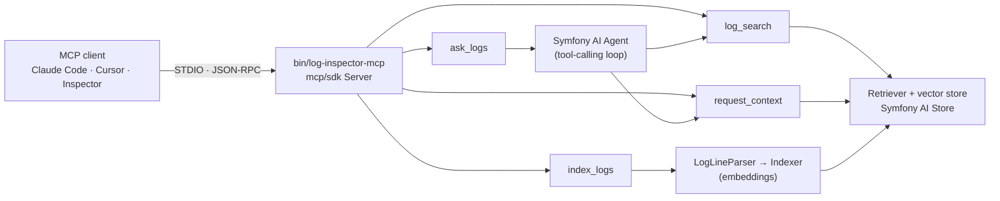

# 🤖 AI Log Inspector Agent

[](https://github.com/RamyHakam/ai-log-inspector-agent/actions/workflows/tests.yml)
[](https://php.net)
[](https://symfony.com/doc/current/ai.html)
[](#-mcp-server-ask-your-logs-from-claude-code-cursor-)
[](#)
[](LICENSE)
<span style="font-size: 2em;">🇵🇸</span> **Free Palestine**

<div align="center">

### 🤖💬 Chat With Your Logs Using Smart AI 💬🤖

**Transform debugging from tedious to effortless!** 🔍 → ⚡  
Stop digging through dashboards and complex queries. Just **ask your logs directly** in plain English.

</div>

---

## 🐌 Traditional vs ⚡ AI-Powered

<table>
<tr>
<td width="50%">

### 🐌 Traditional Way
- Open **Kibana/ElasticSearch** dashboards
- Write complex **Datadog queries**
- Manual `grep` through log files
- Filter thousands of log entries
- Correlate timestamps & request IDs by hand
- Spend hours finding root causes

**Result:** Hours of manual work 😩

</td>
<td width="50%">

### ⚡ AI Agent Way
```php
// Just ask naturally!
$agent->ask("Why did payments fail?");
$agent->ask("What caused the 3 PM outage?");
$agent->ask("Show me timeout patterns");
$agent->ask("How many users affected?");
```

**Result:** Instant intelligent answers 🧠

</td>
</tr>
</table>

---

## 🔌 MCP Server: ask your logs from Claude Code, Cursor, …

> Built for the [Symfony AI & MCP Hackathon](https://symfony.com/hackathon) (Oct 26 – Nov 22, 2026).
> **New in this round:** upgraded to **Symfony AI 1.0** and added an **MCP server and demo client built on the
> official PHP MCP SDK (`mcp/sdk`)**. All of it lives in [`src/Mcp`](src/Mcp), [`src/Parser`](src/Parser),
> [`bin/`](bin) and [`examples/incident-demo`](examples/incident-demo).

Your coding agent already reads your code. Now it can **read your production logs too**: search them semantically,
trace one request across services, and run a full root-cause investigation, all through MCP.



| MCP element | Name | What it does |
|---|---|---|
| tool | `log_search` | Semantic search over indexed logs. Returns evidence plus an explanation |
| tool | `request_context` | Every line for a `request_id` / `trace_id` / `session_id`, in order |
| tool | `ask_logs` | Runs the server-side **Symfony AI agent**, which picks the tools and writes a root-cause report |
| tool | `index_logs` | Index a log file or a directory of `*.log` files |
| resource | `logs://index/stats` | Indexed sources and line counts |
| prompt | `investigate_incident` | A step-by-step incident investigation playbook for the client model |

### ⏱️ From `git clone` to a running demo in 5 minutes

The demo is an MCP **client** (also `mcp/sdk`). It starts the MCP **server**, indexes a simulated outage
([`examples/incident-demo/logs`](examples/incident-demo/logs): a deploy shrinks the DB pool from 50 to 5, checkout
fails, and customers are charged without orders) and investigates it.

```bash
git clone https://github.com/RamyHakam/ai-log-inspector-agent && cd ai-log-inspector-agent
echo "OPENAI_API_KEY=sk-..." > .env

# Option A: Docker
docker compose run --rm demo

# Option B: local PHP 8.4
composer install && php bin/log-inspector-demo

# Ask your own question
php bin/log-inspector-demo "Were any customers charged without getting an order?"
```

No API key? Run fully local with Ollama:

```bash
docker compose --profile local up -d ollama          # pulls llama3.1 + nomic-embed-text on first start
LOG_INSPECTOR_PROVIDER=ollama docker compose run --rm demo
```

### Use it from Claude Code / Cursor

The repository ships an [`.mcp.json`](.mcp.json). Open the folder in Claude Code and the `log-inspector` server is
available. To use it with **your own** logs from any project:

```bash
claude mcp add log-inspector \
  -e OPENAI_API_KEY=sk-... \
  -e LOG_INSPECTOR_PATHS=/path/to/your-app/var/log \
  -- php /path/to/ai-log-inspector-agent/bin/log-inspector-mcp
```

Or with Docker, which needs no local PHP:

```json
{
  "mcpServers": {
    "log-inspector": {
      "command": "docker",
      "args": ["run", "-i", "--rm", "-e", "OPENAI_API_KEY", "-e", "LOG_INSPECTOR_PATHS=/logs",
               "-v", "/path/to/your-app/var/log:/logs:ro", "ai-log-inspector"]
    }
  }
}
```

Then just ask: *"Use log-inspector to find out why checkout failed this afternoon"*, or start from the
`investigate_incident` prompt.

### Configuration (environment variables or `.env`)

| Variable | Default | |
|---|---|---|
| `LOG_INSPECTOR_PROVIDER` | `openai` | `openai`, `anthropic` or `ollama` |
| `LOG_INSPECTOR_MODEL` | `gpt-5.4-mini` / `claude-sonnet-5-5` / `llama3.1` | chat model for the agent |
| `LOG_INSPECTOR_EMBEDDING_PROVIDER` | same as provider (`ollama` for anthropic) | `openai` or `ollama` |
| `LOG_INSPECTOR_EMBEDDING_MODEL` | `text-embedding-3-small` / `nomic-embed-text` | |
| `LOG_INSPECTOR_PATHS` | | comma-separated files or directories to index at startup |
| `OPENAI_API_KEY`, `ANTHROPIC_API_KEY`, `OLLAMA_HOST` | | provider credentials |

The parser understands Monolog / Symfony / Laravel lines (`[ts] channel.LEVEL: message {json} [extra]`),
`[ts] LEVEL: message` and PHP `error_log` output. It extracts `request_id`, `trace_id`, `session_id` and
`span_id` from the JSON context, so `request_context` can trace requests across services.

---

## 📚 Docs & Examples

Live docs: [ramyhakam.github.io/ai-log-inspector-agent](https://ramyhakam.github.io/ai-log-inspector-agent/)

---

## 📚 Playground  To Validate with your own logs and AI platform.

Playground: [ramyhakam.github.io/ai-log-inspector-agent](https://ramyhakam.github.io/ai-log-inspector-agent/playground)

---

## 💬 Real Examples - Ask Anything!

```php
$agent = new LogInspectorAgent($platform, $model, $store);

// 🚨 Checkout Issues
$result = $agent->ask('Why did the last checkout request fail?');
// → "Payment gateway timeout after 30 seconds. The last 3 checkout attempts 
//    all failed with 'gateway_timeout' errors between 14:23-14:25."

// 🔍 Database Problems  
$result = $agent->ask('Show me all database errors from the last hour');
// → "Found 12 database connection failures. Pattern shows connection pool 
//    exhaustion starting at 15:30, affecting user authentication service."

// 🌊 Performance Issues
$result = $agent->ask('What caused the sudden spike in API response times?');
// → "Memory leak in Redis connection causing 2.5s delays. Started after 
//    deployment at 13:45, affecting 847 requests per minute."

// 🔐 Security Monitoring
$result = $agent->ask('Are there any suspicious login attempts?');
// → "Detected brute force attack from IP 192.168.1.100. 156 failed login 
//    attempts in 5 minutes targeting admin accounts."

// 📊 Impact Assessment
$result = $agent->ask('How many users were affected by the outage?');
// → "Based on error logs, approximately 2,341 unique users experienced 
//    service disruption between 14:15-14:32 during the database incident."
```

> ⚠️ **Note** - Built on Symfony AI (experimental). The package itself is NOT production-ready; platform maturity depends on your provider and deployment setup.

---

## ✨ What Makes It Special

🔍 **Semantic Search** - Understands context, not just keywords  
🧠 **AI Analysis** - Explains what happened and why  
⚡ **Lightning Fast** - Get answers in seconds, not hours  
🛠️ **Tool-Based** - Extensible architecture with Symfony AI  
📊 **Vector Powered** - Smart similarity matching  
🔄 **Fallback Ready** - Works even when AI is unavailable  
🌐 **Multi-Platform** - OpenAI, Anthropic, and Ollama support  
🧩 **Multi-Tool** - `log_search` + `request_context` for request tracing  
📂 **File Upload Indexing** - Upload logs and index via `LogFileIndexer`  
💬 **Session Chat** - Persisted chat history for multi-turn investigations  
🧪 **Production Demo** - Check Playground Demo

---

## 🚀 Quick Start

### Requirements
- PHP 8.4+
- Composer 2+

### Install
```bash
composer require hakam/ai-log-inspector-agent
```

### Setup & Use

```php
<?php

require_once __DIR__ . '/vendor/autoload.php';

use Hakam\AiLogInspector\Agent\LogInspectorAgent;
use Hakam\AiLogInspector\Enum\PlatformEnum;
use Hakam\AiLogInspector\Platform\LogDocumentPlatformFactory;
use Hakam\AiLogInspector\Retriever\LogRetriever;
use Hakam\AiLogInspector\Store\VectorLogDocumentStore;
use Hakam\AiLogInspector\Tool\LogSearchTool;
use Hakam\AiLogInspector\Tool\RequestContextTool;
use Symfony\AI\Store\InMemory\Store as InMemoryStore;

// Brain platform (LLM) + Embedding platform
$brainPlatform = LogDocumentPlatformFactory::createBrainPlatform(
    PlatformEnum::OPENAI,
    [
        'api_key' => $_ENV['OPENAI_API_KEY'],
        'model' => 'gpt-4o-mini',
        'model_capabilities' => ['text', 'tool_calling'],
    ]
);
$embeddingPlatform = LogDocumentPlatformFactory::createEmbeddingPlatform(
    PlatformEnum::OPENAI,
    [
        'api_key' => $_ENV['OPENAI_API_KEY'],
        'model' => 'text-embedding-3-small',
    ]
);

// Vector store + retriever
$store = new VectorLogDocumentStore(new InMemoryStore());
$retriever = new LogRetriever(
    embeddingPlatform: $embeddingPlatform->getPlatform(),
    model: 'text-embedding-3-small',
    logStore: $store
);

// Tools + agent
$logSearchTool = new LogSearchTool($store, $retriever, $brainPlatform);
$requestContextTool = new RequestContextTool($store, $retriever, $brainPlatform);
$agent = new LogInspectorAgent($brainPlatform, [$logSearchTool, $requestContextTool]);

// Index a few logs (in-memory)
use Hakam\AiLogInspector\Document\LogDocumentFactory;
use Hakam\AiLogInspector\Indexer\LogDocumentIndexer;

$indexer = new LogDocumentIndexer(
    embeddingPlatform: $embeddingPlatform->getPlatform(),
    model: 'text-embedding-3-small',
    logStore: $store
);

$docs = [
    LogDocumentFactory::createFromString('[2024-01-29 14:23:45] ERROR: Payment gateway timeout'),
    LogDocumentFactory::createFromString('[2024-01-29 14:23:46] ERROR: Stripe API returned 504'),
];
$indexer->indexLogDocuments($docs);

// Ask questions!
$result = $agent->ask('Why did the checkout fail?');
echo $result->getContent();
```
---

### Advanced Questions
```php
// Root cause analysis
$agent->ask('What caused the 500 errors in payment service?');

// Timeline investigation  
$agent->ask('What happened before the database failure?');

// Pattern discovery
$agent->ask('Are there recurring memory leak patterns?');

// Security investigation
$agent->ask('Suspicious auth patterns from IP 192.168.1.100?');
```

### Response Structure
```php
// Tool responses are structured (LogSearchTool / RequestContextTool / Playground API)
[
    'success' => true,                    // Found relevant logs?
    'reason' => 'Payment gateway timeout caused...',  // AI explanation
    'evidence_logs' => [                  // Supporting evidence
        [
            'id' => 'log_001',
            'content' => '[2024-01-15] ERROR: ...',
            'timestamp' => '2024-01-15T14:23:45Z',
            'level' => 'error',
            'source' => 'payment-service', 
            'tags' => ['payment', 'timeout']
        ]
    ]
]
```
`LogInspectorAgent::ask()` returns a `ResultInterface` (use `getContent()` for the AI response). The structured array above is the tool-level output used internally and by the playground API.

---

## ⚙️ Configuration

### AI Platform Options
```php
use Hakam\AiLogInspector\Enum\PlatformEnum;
use Hakam\AiLogInspector\Platform\LogDocumentPlatformFactory;

// OpenAI (brain + embeddings)
$brainPlatform = LogDocumentPlatformFactory::createBrainPlatform(
    PlatformEnum::OPENAI,
    [
        'api_key' => $_ENV['OPENAI_API_KEY'],
        'model' => 'gpt-4o-mini',
        'model_capabilities' => ['text', 'tool_calling'],
    ]
);
$embeddingPlatform = LogDocumentPlatformFactory::createEmbeddingPlatform(
    PlatformEnum::OPENAI,
    [
        'api_key' => $_ENV['OPENAI_API_KEY'],
        'model' => 'text-embedding-3-small',
    ]
);

// Anthropic (brain only, embeddings via OpenAI or local)
$brainPlatform = LogDocumentPlatformFactory::createBrainPlatform(
    PlatformEnum::ANTHROPIC,
    [
        'api_key' => $_ENV['ANTHROPIC_API_KEY'],
        'model' => 'claude-3-5-sonnet-20241022',
        'model_capabilities' => ['text', 'tool_calling'],
    ]
);

// Ollama (local brain + local embeddings)
$brainPlatform = LogDocumentPlatformFactory::createBrainPlatform(
    PlatformEnum::OLLAMA,
    [
        'host' => 'http://localhost:11434',
        'model' => 'llama3.2:1b',
        'model_capabilities' => ['text', 'tool_calling'],
    ]
);
$embeddingPlatform = LogDocumentPlatformFactory::createEmbeddingPlatform(
    PlatformEnum::OLLAMA,
    [
        'host' => 'http://localhost:11434',
        'model' => 'nomic-embed-text',
    ]
);
```

### Vector Store Options
```php
// Memory (testing)
use Symfony\AI\Store\InMemory\Store as InMemoryStore;
$store = new InMemoryStore();

// Production stores
use Symfony\AI\Store\Bridge\Chroma\ChromaStore;
use Symfony\AI\Store\Bridge\Pinecone\PineconeStore;

$store = new ChromaStore($config);
$store = new PineconeStore($config);
```

### Custom System Prompts
```php
$customPrompt = 'You are a security log analyzer. Focus on threats and incidents.';

$agent = new LogInspectorAgent($platform, [$logSearchTool, $requestContextTool], $customPrompt);
```

---

## 🧰 Tools & Capabilities

**LogSearchTool (`log_search`)**
- Semantic or keyword search over indexed logs
- Returns structured results with evidence logs and AI analysis

**RequestContextTool (`request_context`)**
- Trace a request, session, or trace ID across distributed logs
- Returns chronological log context for end-to-end debugging

**Multi-tool agent example**
- See `examples/multi-tool-agent-example.php` for intelligent tool selection

---

## 💬 Conversational Debugging

```php
use Hakam\AiLogInspector\Chat\LogInspectorChatFactory;

$chat = LogInspectorChatFactory::createSession(
    sessionId: 'incident-2026-02-06',
    platform: $platform,
    searchTool: $logSearchTool,
    contextTool: $requestContextTool,
    storagePath: sys_get_temp_dir() . '/log-inspector-sessions'
);

$chat->startInvestigation('Payment outage - Feb 6, 2026');
$chat->ask('What payment errors occurred?');
$chat->followUp('Were there any database issues around that time?');
$summary = $chat->summarize();
echo $summary->asText();
```

---

## 🧪 Playground API 

Run the multi-platform playground API:

```bash
php -S localhost:8080 examples/playground-api.php
```

Key endpoints:
- `GET /health`
- `POST /init` (preload sample logs and cache vectors)
- `POST /upload` (upload log file, index with `LogFileIndexer`)
- `GET /logs`
- `GET /init-status`
- `POST /chat`
- `POST /reset`

Features:
- Separate brain and embedding models per request
- OpenAI, Anthropic, or Ollama per request
- Session-based chat history
- Cached vector store per session

---

Environment variables:
- `OLLAMA_URL` (default: `http://localhost:11434`)
- `OLLAMA_MODEL` (default: `llama3.1:8b`)
- `CHROMA_URL` (default: `http://localhost:8000`)
- `CHROMA_COLLECTION` (default: `log-inspector`)
- `REDIS_URL` (default: `redis://localhost:6379`)
- `ALLOWED_ORIGINS` (default: `*`)

---

## 📚 Local Docs

The documentation site content is in `website/docs`.

Live docs: [ramyhakam.github.io/ai-log-inspector-agent](https://ramyhakam.github.io/ai-log-inspector-agent/)

---

## 🧪 Testing & Validation - **REAL WORKING PACKAGE**

> **🎯 PROOF IT WORKS**: Comprehensive end-to-end tests with real Ollama integration.

### ✅ **Full Functional Test Suite**

**13/13 tests PASSING** with real Ollama (llama3.2:1b):
- 💳 **Payment system analysis** - Real e-commerce error investigation
- 🛡️ **Security incident detection** - Brute force & auth failure analysis  
- 💾 **Database performance issues** - Connection timeouts & query problems
- 🐛 **Application error analysis** - Exception handling & memory issues
- ⚡ **Performance monitoring** - API response time analysis
- 📊 **50+ realistic PHP logs** from actual applications

### 🏃‍♂️ **Run Tests Yourself**

```bash
# Setup Ollama
curl -fsSL https://ollama.ai/install.sh | sh
ollama pull llama3.2:1b

# Run full test suite
OLLAMA_MODEL=llama3.2:1b vendor/bin/phpunit test/Functional/
```

**Results**: 104 successful assertions, 2-10s response times, multi-platform support proven.

### 🚀 **Extend Testing**

**Want to test with YOUR logs?** Add more realistic log examples:

1. **Expand `test/fixtures/logs/`** with logs from:
   - ✅ **Laravel applications** - Real Laravel/Eloquent errors (included)
   - ✅ **Kubernetes pods** - OOMKilled, CrashLoopBackOff, resource issues (included)
   - ✅ **Microservices** - Circuit breakers, service mesh, distributed tracing (included)
   - Symfony applications  
   - API gateways
   - Docker containers

2. **Test real scenarios**:
   - "What caused the 3 AM outage?"
   - "Show me memory leaks in user service"
   - "Find all failed credit card transactions"
   - "Analyze API rate limiting errors"

3. **Validate with your AI platform**:
   - OpenAI (full semantic search)
   - Anthropic (full semantic search)
   - Ollama (intelligent keyword fallback)

**This package works with REAL data and REAL AI models - test it yourself!**

---

## 🤝 Contributing

1. **Fork** the repository
2. **Create** feature branch: `git checkout -b feature/amazing-feature`
3. **Commit** changes: `git commit -m 'Add amazing feature'`
4. **Push** to branch: `git push origin feature/amazing-feature`
5. **Open** Pull Request

---

<div align="center">

**Made with ❤️ for developers who hate digging through logs!**

*Transform your debugging experience today* 🚀

</div>
